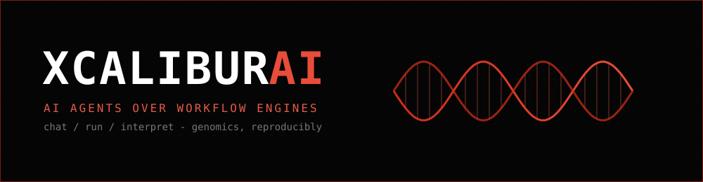
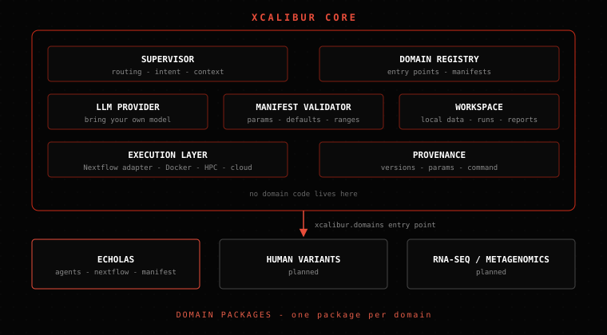

<div align="center">
  
</div>

<br/>

<div align="center">
  <a href="LICENSE"></a>
  <a href="CHANGELOG.md"></a>
  
  
  <a href="https://github.com/BrunoFOmena/XcaliburAI/actions/workflows/ci.yml"></a>
</div>

<br/>

---

> **Status: pre-alpha (v0.0.0).** The core skeleton and the ECHOLAS domain contract exist; the pipeline itself and the LLM-driven agents are still being built. Nothing here is ready for production analysis.

# Quickstart

**1. Install (development):**
```bash
git clone https://github.com/BrunoFOmena/XcaliburAI.git && cd XcaliburAI
python -m venv .venv && source .venv/bin/activate
pip install -e . -e packages/xcalibur-echolas
```

**2. See what is installed:**
```bash
xcalibur version
xcalibur domains
```

**3. Plan a run (validates parameters, prints the workflow command, executes nothing):**
```bash
xcalibur plan echolas -i raw_data=./raw_data -i reference=./reference
```

**The goal** is to replace step 3 with a conversation:
```text
> Run the pipeline on my samples against the M2904 reference, show the population
  structure, and tell me which clade my new sample belongs to.
```

<br/>

# CLI Reference

```bash
xcalibur version                         # print the version
xcalibur domains                         # list installed domain packages
xcalibur plan <domain> -p KEY=VALUE      # validate params and show the workflow command
                      -i NAME=PATH       #   (dry run; nothing is executed)
```
Chat (`xcalibur chat`) and `xcalibur run` arrive with the agent layer.

<br/>

# 🧠 Architecture

XcaliburAI is a multi-agent system built as a **small core plus domain packages**. The core knows nothing about any specific domain; a domain is a package that plugs in through a Python entry point.

* **Supervisor:** routes each message to the right domain and agent.
* **Domain registry:** discovers installed packages through the `xcalibur.domains` entry point.
* **Manifest validator:** every domain declares its inputs, parameters, ranges, and safe defaults. Requests are validated *before* anything runs, so an agent cannot silently pass bad parameters.
* **Execution layer:** one adapter per workflow engine (Nextflow first). Agents ask to "run this package with these parameters"; they never build shell commands.
* **Provenance:** versions, parameters, and the exact command are recorded for every run.
* **Local-first:** data stays in the workspace on your machine. You bring your own LLM provider; keys are read from environment variables and never stored.

<div align="center">
  
</div>

<br/>

More detail in [docs/ARCHITECTURE.md](docs/ARCHITECTURE.md). The architecture pattern is inspired by [Lobster AI](https://github.com/the-omics-os/lobster); XcaliburAI is an independent implementation and **shares no code** with it.

<br/>

# 🧬 Domains

| Order | Domain | Scope | Status |
|---|---|---|---|
| 1 | **ECHOLAS** | *Leishmania* population genomics from short reads | 🔴 in progress |
| 2 | Human & clinical variants | WGS/WES, annotation, prioritization | ⚪ proposed |
| 3 | Bulk RNA-seq | Quantification, differential expression, enrichment | ⚪ proposed |
| 4 | Metagenomics & microbiome | Taxonomic and functional profiling | ⚪ proposed |

### ECHOLAS (current scope)

*Evolutionary Comparison and Hierarchical Organization on Leishmania Analysis.* Adaptive QC and trimming → alignment → joint variant calling → filtering → PCA and maximum-likelihood phylogeny, plus diversity, Fst, and clade divergence. It originates from [MCamposDA/ECHOLAS](https://github.com/MCamposDA/ECHOLAS), authored by a cofounder.

### Expansion principles

- **Depth before breadth:** a new domain starts only when the previous one is solid.
- **Own implementation first.** [nf-core](https://nf-co.re) pipelines may serve as a starting point for future domains through a generic adapter, but our preference is implementing pipelines and agents ourselves.
- Adding a domain means adding a package. The core does not change. See [docs/DOMAIN_PACKAGES.md](docs/DOMAIN_PACKAGES.md).

<br/>

# 🛠️ Build Your Own Domain

A domain package is a small Python package with a `manifest.yaml`, its workflow, and its agents, registered like this:

```toml
[project.entry-points."xcalibur.domains"]
echolas = "xcalibur_echolas:plugin"
```

[`packages/xcalibur-echolas`](packages/xcalibur-echolas) is the reference example.

<br/>

# FAQ

<details>
<summary><b>Why agents over workflow engines instead of agents that call libraries?</b></summary>

Genomics pipelines are heavy, containerized, and need to be reproducible. Putting the agent *in front of* a workflow engine keeps the rigor of the pipeline while removing the expertise barrier of configuring and interpreting it.
</details>

<details>
<summary><b>Which LLMs can I use?</b></summary>

The core defines a provider-agnostic interface ([`xcalibur/llm`](src/xcalibur/llm/base.py)). Concrete providers arrive with the agent layer.
</details>

<details>
<summary><b>Can the agent break my data or invent parameters?</b></summary>

Parameters are validated against the domain manifest (types, ranges, choices, unknown keys rejected) before execution, and every run writes a provenance record. Treat results as plausible-but-verify until the project leaves pre-alpha.
</details>

<details>
<summary><b>How do I contribute?</b></summary>

Read [CONTRIBUTING.md](CONTRIBUTING.md). Pull requests always target `homolog`; only `homolog` is promoted to `main`.
</details>

<br/>

# 🌿 Branching & Versioning

```
feature/*  ──PR──▶  homolog  ──PR──▶  main
```

- `main` is the stable, released line. It only receives pull requests from `homolog`.
- `homolog` is the integration and testing branch. Every other branch opens its PR against `homolog`.
- Pull requests are mandatory, require one approving review, and must pass CI.
- Versions follow `MAJOR.MINOR.PATCH` ([Semantic Versioning](https://semver.org)); the project starts at **0.0.0**. Rules in [docs/VERSIONING.md](docs/VERSIONING.md), history in [CHANGELOG.md](CHANGELOG.md).

<br/>

# 👥 Cofounders

XcaliburAI is co-founded by two cofounders.

| Cofounder | Role | GitHub |
|---|---|---|
| Bruno F. Omena | CTO, code owner of the repository | [@BrunoFOmena](https://github.com/BrunoFOmena) |
| MCamposDA | CEO | [@MCamposDA](https://github.com/MCamposDA) |

The CTO manages the repository and its branches and is the code owner: pull requests, including the CEO's, need the CTO's approval. See [CONTRIBUTING.md](CONTRIBUTING.md).

<br/>

# 📄 License

[GNU Affero General Public License v3.0 or later](LICENSE). The core and official domain packages are open source. If you run a modified version as a network service, the AGPL requires you to offer its source to your users.
